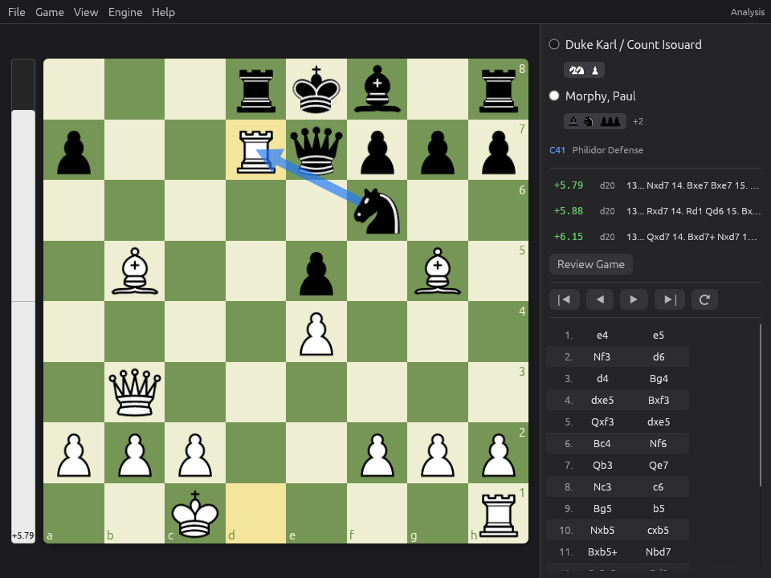

# Chessy

> A native chess GUI built with Rust, egui, and Stockfish.

<p align="center">
  
</p>

---

## Features

**Analysis**

- [Stockfish](https://stockfishchess.org/) engine integration with multi-line evaluation, depth, and suggested move sequences
- Best-move arrow on the board, plus your own arrows and square marks (right-drag and right-click)
- Game review: accuracy per side, inaccuracy / mistake / blunder marks in the move list, and a clickable evaluation graph
- Opening names with ECO codes, matched by position so transpositions are recognised
- Variations: try another move at any point without losing the original line, switch between lines, promote or delete them
- Set up any position, or paste a FEN

**Playing against the engine**

- Strength presets or a custom Elo limit
- Chess clocks: 1+0, 3+2, 5+0, 10+0, 15+10 and 30+0, with increments and loss on time
- Takeback, hint and resign, and "Play from Current Position" to continue any position against the engine
- Draws by threefold repetition and the fifty-move rule, with sounds for moves, captures, draws, wins and losses

**Games and files**

- PGN import and export, including variations; Copy PGN to the clipboard
- Multi-game PGN files open in a game picker with filtering
- `chessy game.pgn` opens a file on launch

**Board and interface**

- Native desktop UI powered by [egui](https://github.com/emilk/egui), with dark and light themes
- Three piece sets and four board colour themes, optional coordinates, and move animation
- Captured pieces and material balance beside the player names
- Move history navigation and board flipping

## Controls

| Action | Control |
|---|---|
| Step through moves | `←` / `→`, `Home` / `End` |
| Flip board | `F` |
| New game, open PGN, save PGN | `Ctrl/Cmd+N`, `Ctrl/Cmd+O`, `Ctrl/Cmd+S` |
| Copy PGN | `Ctrl/Cmd+Shift+C` |
| Draw an arrow / mark a square | Right-drag / right-click on the board |
| Clear arrows and marks | Left-click on the board |

## Install

Download the latest build for your platform from [Releases](../../releases).

Stockfish must be installed separately: `brew install stockfish` (macOS), `sudo apt install stockfish` (Linux), or [download](https://stockfishchess.org/download/) (Windows).

### macOS

Open the DMG and drag **Chessy** to Applications. The app is not notarized (no paid Apple Developer account), so the first launch shows a Gatekeeper warning:

1. Double-click Chessy — macOS says it can't verify the app. Click **Done** (not "Move to Trash").
2. Open **System Settings → Privacy & Security**, scroll down, and click **Open Anyway**.
3. Confirm — this is only needed once.

Or skip the dialogs entirely with: `xattr -dr com.apple.quarantine /Applications/Chessy.app`

### Linux / Windows

Extract the archive and run `chessy` (or `chessy.exe`) from inside the extracted folder — the `assets/` directory must stay next to the binary.

## Build from source

| Requirement | Notes |
|---|---|
| Rust (2024 edition) | Install via [rustup](https://rustup.rs/) |
| Stockfish | Must be available in `$PATH` — [download](https://stockfishchess.org/download/) |

```sh
cargo run --release
```

## License

[LICENSE](LICENSE)
